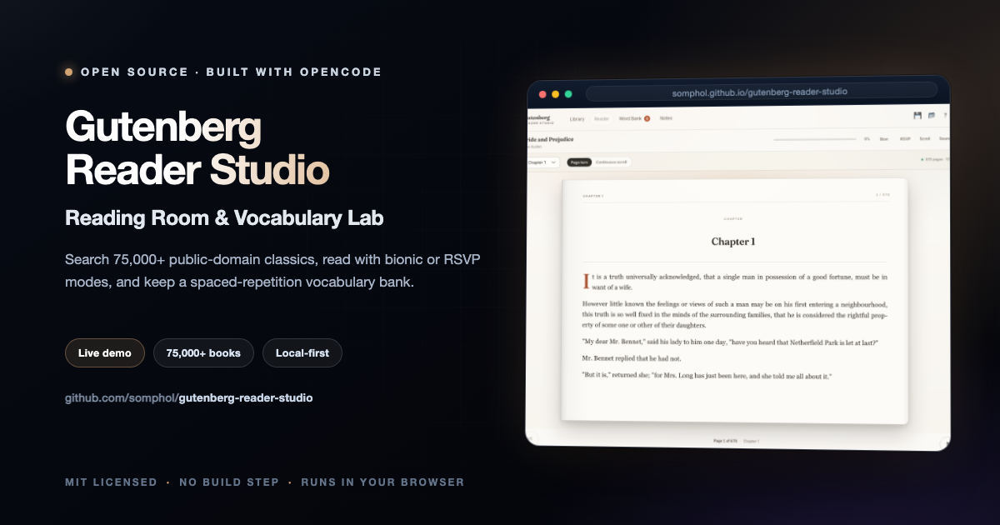
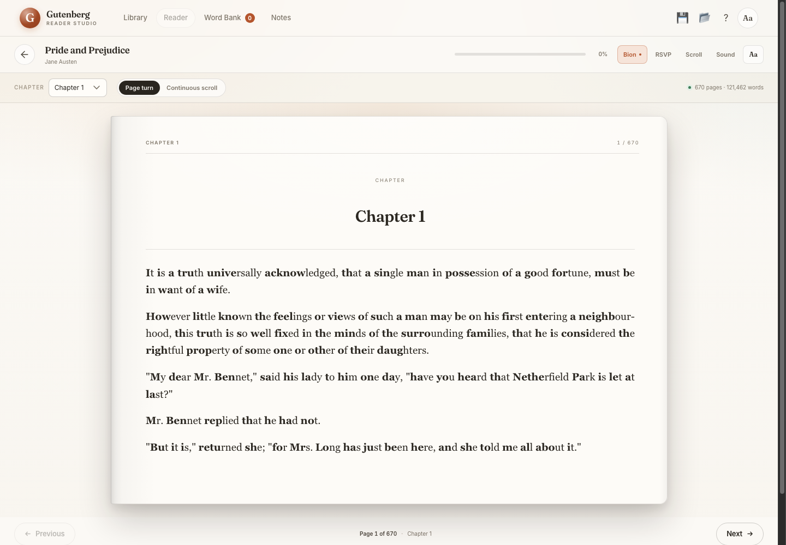
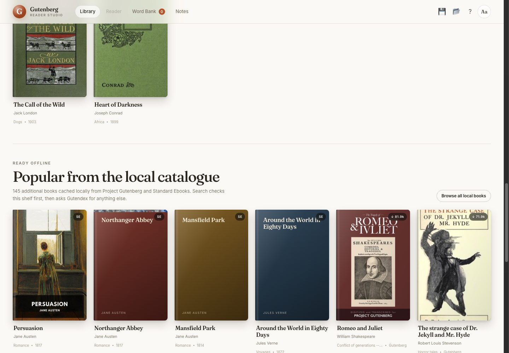
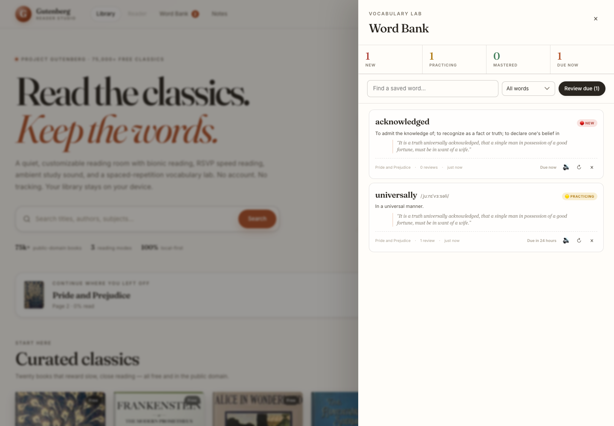

<div align="center">



# Gutenberg Reader Studio & Vocabulary Lab

**A Reading Room for the Public Domain**

Search 75,000+ classics, read with bionic or RSVP modes, listen with browser-native read-aloud narration, and keep every unfamiliar word in a spaced-repetition vocabulary bank.

[](https://somphol.github.io/gutenberg-reader-studio/)
[](LICENSE)

**[Try it live →](https://somphol.github.io/gutenberg-reader-studio/)**

</div>

---

## What it does

### Discover and read

- **Gutendex search** across Project Gutenberg’s catalogue, with language filtering, popular-first ordering, genre browsing, and paged results.
- **A 165-book local catalogue** — 20 hand-picked classics, 140 popular Gutenberg titles, and unique Standard Ebooks editions. Search checks this shelf first, so common searches return instantly without waiting for Gutendex.
- **Standard Ebooks as a second text source** — single-page XHTML is cleaned and paginated the same way as Gutenberg text.
- **Search caching** — Gutendex responses are cached in `localStorage` for 7 days, and opened full texts are cached in IndexedDB for instant reopen.
- **Twenty curated classics** with hand-checked covers and reliable public-domain text sources.
- **Automatic text cleanup** removes the Gutenberg header, license, transcriber notes, illustration markers, and page furniture.
- **Chapter detection** for `CHAPTER`, `BOOK`, `PART`, `LETTER`, `ACT`, `SCENE`, and common front-matter headings.
- **Typography-first reader** with a paper page, running head, page numbers, justified prose, poetry blocks, italics, and an optional drop cap.
- **3D page-turn animation** or a continuous vertical scroll, switchable at any time without losing your place. The outgoing page hinges on the spine and swings left to reveal the next page already waiting underneath.

### Customize the reading room

| Control | Options |
| --- | --- |
| Theme | Light paper `#FBF9F5`, Warm sepia `#F4ECD8`, Midnight dark `#1E222A`, OLED black `#000000` |
| Typeface | Georgia (classic serif), Inter (clean sans), OpenDyslexic (accessibility) |
| Font size | 14px – 32px |
| Line height | 1.2× – 2.2× |
| Definition card text | 12px – 20px |
| Read-aloud voice & speed | Every installed platform voice, grouped by accent, with preview and on-device/online labels; 0.5× – 2× |

All settings apply live and are remembered in `localStorage`.

### Focus and speed modes

- **Bionic reading** — bolds the first ~42% of letters in every word to give the eye an anchor. Double-clicking a bionic word still looks up the whole word, not the bold fragment.
- **RSVP speed reader** — one word at a time on a fixed focal point, 150–500 words per minute, with punctuation pauses, keyboard stepping, and a progress bar.
- **Read aloud (TTS)** — narrates the page sentence by sentence with a moving highlight, play/pause, sentence stepping, and optional automatic page turns. The voice picker lists every voice your platform provides, grouped by accent with on-device/online labels, inferred voice character, a preview button, and a refresh control. Automatic mode prefers an on-device voice so narration still works offline.
- **Teleprompter auto-scroll** — hands-free scrolling at an adjustable speed. Scrolling manually pauses it.
- **Ambient soundscapes** — rain, café murmur, and fireplace crackle synthesized live with the Web Audio API. No audio files, no downloads.



### Build a vocabulary

- **Double-click or select any word** to open a definition card with phonetics, audio, parts of speech, and definitions from the Free Dictionary API.
- **Definition card controls** — the card is a roomy 500px on desktop (full-width bottom sheet on mobile) with **A− / A+** text-size controls from 12px to 20px. The setting is remembered with the rest of the studio.
- **Context extraction** automatically captures the sentence around the word from the book.
- **➕ Add to Word Bank** stores the word, definition, phonetic, audio URL, source book, and context.
- **SRS review** moves words from 🔴 New to 🟡 Practicing to 🟢 Mastered using real timestamp math.
- **Due now** queue, review flashcards, Again / Good / Easy grading, and a searchable, filterable word bank.
- **Notes** capture a thought against the current book and page, with edit, delete, and undo.

### Keep everything

- Automatic `localStorage` saves for the active book, page, scroll percentage, settings, notes, and Word Bank.
- **💾 Save Reading Library** downloads `gutenberg_studio_state.json`.
- **📂 Load Reading Library** restores the whole studio on another browser or device.
- Nothing is uploaded anywhere.

## Quick start

```bash
cd gutenberg-reader-studio
python3 -m http.server 8000
```

Open <http://localhost:8000/>.

A local server is recommended over opening `index.html` directly because `fetch`, the Gutendex API, and the dictionary lookup all behave better with an HTTP origin.

### Deploy to GitHub Pages

1. Push the repository to GitHub.
2. Open **Settings → Pages**.
3. Set **Source** to **Deploy from a branch**.
4. Choose `main` and `/ (root)`.
5. Save. The site publishes at `https://<user>.github.io/<repo>/`.

`.nojekyll` is included so the files are served as-is. There is no build step or Actions workflow.

## How the text gets here

Project Gutenberg does not send an `Access-Control-Allow-Origin` header for plain text, so the studio uses a layered, CORS-friendly strategy:

1. **GITenberg archive** on `raw.githubusercontent.com` — the primary source. Curated books have an explicit repository and text file; search results are matched by Gutenberg ID through the GitHub API, then by derived repository names.
2. **Standard Ebooks** — a second public-domain source for selected titles. The studio fetches the single-page XHTML, removes front matter, notes, and colophons, and extracts chapter headings and paragraphs.
3. **Direct Project Gutenberg** mirrors — attempted for environments that permit them.
4. **Public CORS relays** — a last-resort fallback for the Gutenberg text URL.

### Search is local-first

The studio ships with a **165-book local catalogue**: 20 curated classics, 140 popular Gutenberg titles, and unique Standard Ebooks editions. Search and genre browsing filter this shelf synchronously, so results appear immediately. Gutendex is then asked to supplement the list in the background.

- If Gutendex is slow or unavailable, the local matches remain usable.
- Catalogue titles with a Standard Ebooks edition use that edition as a fast fallback before the slower Gutenberg/GITenberg/relay chain.
- Gutendex responses are cached for 7 days, so a repeat search does not wait on the network.
- Opened full texts are cached in IndexedDB. Reopening a book skips the download and goes straight to pagination.
- The only time you see “Searching the full Gutendex catalogue…” is when neither the local shelf nor the search cache has a match.



Gutendex metadata is fetched from `https://gutendex.com/books/`. If the direct request is blocked by a network, a public relay is tried before the search shows an error.

The Free Dictionary API (`https://api.dictionaryapi.dev/api/v2/entries/en/<word>`) supplies definitions, phonetics, and pronunciation audio. Dictionary responses are cached in `localStorage` for 30 days.

## Spaced repetition

Each saved word stores `status`, `reviewCount`, `intervalIndex`, `lastReviewed`, and `nextReviewDue`.

| Review count | Status | Next interval |
| ---: | --- | ---: |
| 0 | 🔴 New | Ready now |
| 1 | 🟡 Practicing | +1 day |
| 2 | 🟡 Practicing | +3 days |
| 3 | 🟡 Practicing | +7 days |
| 4 | 🟢 Mastered | +14 days |
| 5 | 🟢 Mastered | +30 days |
| 6+ | 🟢 Mastered | +60 days |

- **Again** resets the interval to 10 minutes.
- **Good** advances one interval.
- **Easy** skips ahead one extra interval.
- A word is due when `nextReviewDue` is at or before the current time.



## Keyboard shortcuts

| Key | Action |
| --- | --- |
| `←` / `→` | Previous / next page (or scroll by a screen) |
| `B` | Toggle bionic reading |
| `R` | Open the RSVP speed reader |
| `L` | Start / stop reading aloud |
| `T` | Toggle teleprompter auto-scroll |
| `S` | Open reader settings |
| `W` | Open the Word Bank |
| `N` | Open notes |
| `/` | Focus library search |
| `?` | Open the help guide |
| `Esc` | Close the current panel, popup, or overlay |
| `Space` | Play / pause read-aloud narration, or play / pause RSVP |
| `Ctrl/Cmd + S` | Export the reading library |

## Data model

The exported `gutenberg_studio_state.json` contains:

```json
{
  "version": 1,
  "settings": {
    "theme": "paper",
    "font": "georgia",
    "fontSize": 19,
    "lineHeight": 1.65,
    "bionic": false,
    "pageTurn": true,
    "rsvpWpm": 260,
    "teleprompterSpeed": 30,
    "ambient": "off",
    "ambientVolume": 0.45,
    "ttsRate": 1,
    "ttsVoice": "",
    "ttsAutoAdvance": true
  },
  "library": {
    "activeBookId": 1342,
    "books": { "1342": { "title": "Pride and Prejudice", "progress": {} } },
    "recent": [1342]
  },
  "wordBank": { "wandering": { "word": "wandering", "reviewCount": 1 } },
  "notes": { "1342": [{ "text": "A note", "page": 12 }] },
  "stats": { "wordsCaptured": 1, "reviews": 1, "readingSeconds": 0 }
}
```

Book text itself is not stored — it is re-fetched and re-paginated when you reopen a book, which keeps the state file small and portable.

## Privacy

- No analytics, tracking, cookies, accounts, or server.
- Reading positions, notes, and vocabulary live in `localStorage` and in files you explicitly export.
- Network requests are limited to Project Gutenberg/GITenberg and Standard Ebooks text, Gutendex metadata, the Free Dictionary API, and optional Google Fonts / jsDelivr font files.
- Full book text opened in the reader is cached locally in IndexedDB so it can reopen without another download.
- Speech audio is played by the browser; the app does not record or upload audio or book text. Read-aloud narration uses your browser's or device's speech engine.

## Browser support

| Feature | Recommended browsers |
| --- | --- |
| Reader, themes, SRS, notes, import/export | All modern browsers |
| 3D page-turn and Web Audio ambience | Chrome, Edge, Safari, Firefox |
| Dictionary pronunciation audio | Any browser with `Audio` |
| Read-aloud narration (TTS) | Any browser with `speechSynthesis` and installed voices |
| Word-highlight karaoke while listening | Chrome, Edge, Safari (CSS Custom Highlight API); sentence highlighting works everywhere |

On screens 720px wide or narrower the reader starts in continuous scroll mode, which is more comfortable on a phone. You can still switch to 3D page-turn at any time.

## Project structure

```text
gutenberg-reader-studio/
├── index.html      # Semantic shell, library, reader, drawers, modals
├── style.css       # Editorial design system, themes, page-turn, responsive UI
├── script.js       # Gutendex/GITenberg, pagination, bionic, RSVP, SRS, audio
├── favicon.svg
├── screenshot.png
├── screenshot-reader.png
├── screenshot-bionic.png
├── screenshot-rsvp.png
├── screenshot-settings.png
├── screenshot-wordbank.png
├── screenshot-catalog.png
├── screenshot-mobile.png
├── README.md
├── STATE.md
├── state.json
├── LICENSE
├── .nojekyll
└── .gitignore
```

## Build provenance

This studio was built in a single agent session with **OpenCode 2.2.5** and **DeepSeek V4.1 Flash** (`opencode-go/deepseek-v4.1-flash`). The exact elapsed time, token usage, session ID, and verification notes are recorded in [`state.json`](state.json) and [`STATE.md`](STATE.md). The in-app **Build state** link in the footer opens the raw state file.

## Credits

- Books: [Project Gutenberg](https://www.gutenberg.org/) and [Standard Ebooks](https://standardebooks.org/). Gutenberg text mirrors: [GITenberg](https://github.com/GITenberg).
- Discovery: [Gutendex](https://gutendex.com/).
- Definitions and pronunciation: [Free Dictionary API](https://dictionaryapi.dev/).
- Fonts: [Fraunces](https://fonts.google.com/specimen/Fraunces) and [Inter](https://fonts.google.com/specimen/Inter) via Google Fonts; [OpenDyslexic](https://opendyslexic.org/) via Fontsource/jsDelivr.
- Built with [OpenCode](https://opencode.ai) and **DeepSeek V4.1 Flash**.

Project Gutenberg is a registered trademark of the Project Gutenberg Literary Archive Foundation. This is an independent reading project and is not affiliated with Project Gutenberg, Gutendex, or the Free Dictionary API.

## Contributing

Contributions are welcome — bug reports, feature ideas, accessibility improvements, and
documentation fixes alike. Please read [CONTRIBUTING.md](CONTRIBUTING.md) and the
[Code of Conduct](CODE_OF_CONDUCT.md) before opening a pull request.

- **Found a bug?** [Open a bug report](https://github.com/somphol/gutenberg-reader-studio/issues/new?template=bug_report.yml)
- **Have an idea?** [Request a feature](https://github.com/somphol/gutenberg-reader-studio/issues/new?template=feature_request.yml)
- **Found a vulnerability?** Please follow [SECURITY.md](SECURITY.md) and report it privately.

## Documentation

| Document | Purpose |
| --- | --- |
| [README.md](README.md) | Overview, setup, controls, and architecture |
| [CHANGELOG.md](CHANGELOG.md) | Notable changes and release history |
| [CONTRIBUTING.md](CONTRIBUTING.md) | Local workflow, constraints, and pull request checks |
| [SECURITY.md](SECURITY.md) | Supported versions and private vulnerability reporting |
| [STATE.md](STATE.md) | Build timing, verification record, and token usage |
| [LICENSE](LICENSE) | MIT licence |

## License

MIT — see [LICENSE](LICENSE).
